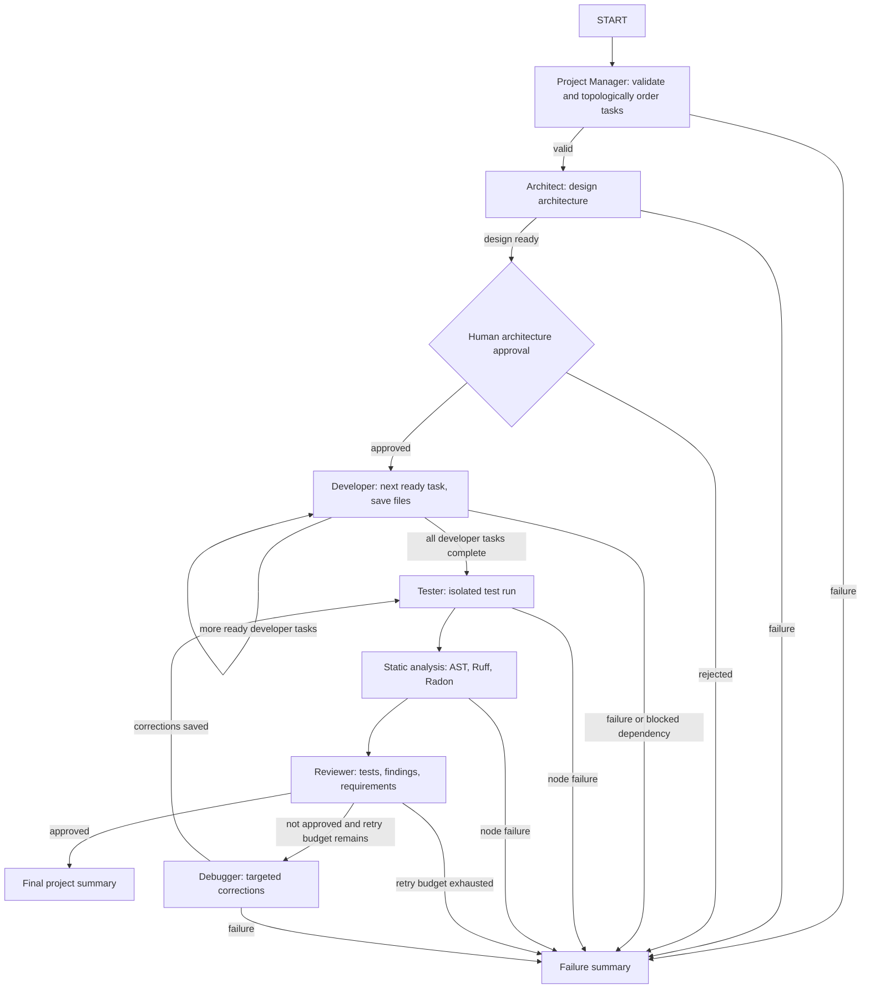

# DevForge AI

DevForge AI is a Python-based, multi-agent assistant intended to automate
parts of the software development lifecycle. Specialized agents will
collaborate through a LangGraph workflow, use Groq for language-model
inference, and expose project operations through a FastAPI backend.

The repository includes specialized agent implementations, LangGraph
orchestration, isolated code/test execution, a FastAPI backend, and SQLite
persistence for projects and their development history.

## Architecture

- `app/agents/` — specialized project manager, architect, developer, tester,
  reviewer, and debugger agents.
- `app/graph/` — shared workflow state, nodes, and LangGraph orchestration.
- `app/tools/` — file management, code execution, test running, and analysis.
- `app/models/` — Pydantic API schemas and SQLite persistence setup.
- `app/services/` — application-level project operations.
- `app/config/` — typed settings loaded from environment variables.
- `app/main.py` — FastAPI application and HTTP routes.
- `frontend/` — React/Vite dashboard for projects and workflow activity.
- `tests/` — pytest checks for the application and module scaffold.
- `generated_projects/` — workspace for generated project output, excluded
  from version control except for its placeholder file.

## LangGraph development workflow

`app.graph.workflow.build_workflow()` compiles the graph from independent agent
nodes. Task planning validates dependency IDs and uses a queue-based
topological sort; dependency-ready developer tasks are generated one at a time
and saved through the confined FileManager. Architecture approval interrupts
the graph before any source is generated. The graph then tests, statically
analyzes, and reviews files, routing rejected work through a bounded
debug-and-retest loop.



The API's `WorkflowRunner` compiles the graph with the persistent SQLite
checkpointer. For direct graph use, supply a checkpointer explicitly and keep
its context open for the entire workflow, including approval and resume:

```python
from langgraph.checkpoint.sqlite import SqliteSaver
from langgraph.types import Command

from app.graph.state import create_initial_state
from app.graph.workflow import build_workflow
from app.models.schemas import ProjectRequest

request = ProjectRequest(
    project_name="sample-project",
    description="Create a small Python calculator.",
    requirements=["Provide an addition function."],
    programming_language="Python",
)

with SqliteSaver.from_conn_string("workflow_checkpoints.sqlite3") as checkpointer:
    graph = build_workflow(checkpointer=checkpointer, max_debugging_attempts=3)
    config = {"configurable": {"thread_id": "project-42"}}
    paused = graph.invoke(create_initial_state(request), config=config)
    # Inspect paused["__interrupt__"], then resume this same thread:
    result = graph.invoke(Command(resume={"approved": True}), config=config)
```

The API uses the stable thread ID `project-{project_id}` and stores checkpoints
in the separate database configured by `WORKFLOW_CHECKPOINT_DB_PATH`
(default: `workflow_checkpoints.sqlite3`). The SQLite checkpointer package is
pinned to version 3.0.1 to match the installed LangGraph checkpoint 3.x API.
WorkflowRunner closes its SQLite connection during shutdown and serializes
graph runs through that synchronous saver. This local SQLite setup is intended
for lightweight, single-process deployments; it is not a horizontally scaled
multi-process checkpoint service.

## Requirements

- Python 3.11 or newer
- A Groq API key when LLM-backed features are implemented

SQLite is available through Python's standard library; no separate database
server is needed for the planned initial storage layer.

## Database persistence

The SQLAlchemy ORM stores projects and their history in the configured
`DATABASE_URL` (default: `sqlite:///./devforge.db`). Initialize the schema and
use the service layer independently of agents:

```python
from app.models.database import Database
from app.models.schemas import ProjectRequest
from app.services.project_service import ProjectService

database = Database()
database.create_all()
projects = ProjectService(database, initialize_schema=False)
project = projects.create_project(
    ProjectRequest(
        project_name="sample-project",
        description="A project whose history is persisted.",
        requirements=["Record development work."],
        programming_language="Python",
    )
)
```

Projects own development tasks, agent execution history, generated-file
versions, and test execution history. Tasks reference dependencies through a
many-to-many join table. Child history rows cascade when a project is deleted.
Repeated task IDs update the existing project task; identical consecutive
generated-file content does not create another version. Agent executions
remain append-only unless a caller supplies the same idempotency key.

The service wraps each operation in a transaction. Tests use independent
temporary SQLite database files and do not touch the configured application
database.

## FastAPI

Run the API from the project root in Windows PowerShell:

```powershell
.\.venv\Scripts\Activate.ps1
python -m uvicorn app.main:app --reload
```

Swagger UI is available at `http://127.0.0.1:8000/docs`. Create a project with
`POST /api/projects`, then call `POST /api/projects/{id}/start` to schedule its
workflow. This returns `202 Accepted`; poll
`GET /api/projects/{id}/status` instead of holding the original request open.
The create request uses the `ProjectRequest` fields (`project_name`,
`description`, `requirements`, `programming_language`, and optional
`preferred_framework`). Submit an approval decision as
`{"approved": true}` or `{"approved": false}`.
The API also exposes project details, task dependencies, generated-file
metadata and version history, execution-log metadata, test totals, and the
persisted `/workflow` report with architecture, test, analysis, review, and
debugging results. Retrieve source for one listed file with
`GET /api/projects/{id}/files/{file_path}?version={version}`; this endpoint
reads only that project's stored file content. Execution logs omit raw prompts
and agent outputs.
The API allows loopback clients without a token for local development. Set a
strong `API_ACCESS_TOKEN` in the environment or `.env` to permit remote clients;
when configured, all endpoints other than `/health` require
`Authorization: Bearer <token>`. Remote access without a token is rejected.
This shared-token mechanism is a deployment guard, not per-user identity or
per-project authorization.

## Frontend dashboard

The React/Vite dashboard lives in `frontend/`. It uses the existing FastAPI
routes only; the Vite development server proxies `/api` and `/health` to
`http://127.0.0.1:8000`.
Use Node.js 20.19+, 22.13+, or 24+ for the frontend toolchain (ESLint 10
requires one of these supported releases).

In Windows PowerShell, start the backend in one terminal:

```powershell
.\.venv\Scripts\Activate.ps1
python -m uvicorn app.main:app --reload
```

In a second terminal:

```powershell
Set-Location .\frontend
npm install
npm run dev
```

Open `http://127.0.0.1:5173`. If the backend has `API_ACCESS_TOKEN`
configured, use the key button in the dashboard to enter it; the token is
kept in session storage only. To build the static frontend, run
`npm run build` from `frontend/`. For a separately hosted production UI, set
`VITE_API_BASE_URL` at build time and configure a same-origin/reverse proxy or
an appropriate authenticated deployment; the development proxy is not part
of the production build.

The dashboard uses the persisted workflow snapshot and project-scoped file
content endpoint. It displays actual test output, analysis, review scores and
findings, debugging attempts, and file versions when those results are
available; it does not fabricate agent activity or results. The separate
`/execute` operation runs a chosen generated Python entry point using the same
Docker sandbox and can be polled through `/execution`.

### API routes used by the dashboard

- `POST /api/projects`, `GET /api/projects`, `GET /api/projects/{id}`
- `POST /api/projects/{id}/start`, `GET /api/projects/{id}/status`
- `GET /api/projects/{id}/workflow`, `POST /api/projects/{id}/approval`
- `GET /api/projects/{id}/tasks`, `GET /api/projects/{id}/files`
- `GET /api/projects/{id}/files/{file_path}?version={version}`
- `GET /api/projects/{id}/logs`, `GET /api/projects/{id}/tests`
- `POST /api/projects/{id}/execute`, `GET /api/projects/{id}/execution`

Architecture generation pauses for human approval. The status response
includes the proposed architecture while approval is pending. Submit
`{"approved": true}` or `{"approved": false}` to
`POST /api/projects/{id}/approval`; the API resumes the same LangGraph thread
in a background worker. Project status and workflow progress are persisted in
the project database. LangGraph state is checkpointed separately in the SQLite
file configured by `WORKFLOW_CHECKPOINT_DB_PATH` (default:
`workflow_checkpoints.sqlite3`), so approval can resume after an API restart.
The runner closes its checkpointer and worker pool at process exit. The
synchronous SQLite saver is intended for a lightweight, single-process
deployment; it serializes graph runs and is not a horizontally scaled
multi-process checkpoint service.

## Setup

Use Python 3.11 or newer. From the project root, create and activate a virtual
environment in Windows PowerShell. Create it only if it does not already
exist. First confirm that the Python launcher selects a supported version
with `py -3 --version`:

```powershell
if (-not (Test-Path .\.venv\Scripts\python.exe)) {
    py -3 -m venv .venv
}
.\.venv\Scripts\Activate.ps1
python -m pip install --upgrade pip
python -m pip install -r .\requirements.txt
if (-not (Test-Path .\.env)) { Copy-Item .\.env.example .\.env }
```

Set `GROQ_API_KEY` and, optionally, `GROQ_MODEL` in `.env` to configure the
Groq integration. The API can start without a key; requesting a Groq chat
model without one raises a clear configuration error. API keys are stored as
Pydantic `SecretStr` values and are not included in settings representations.

The settings class reads values from environment variables (for example
`$env:GROQ_MODEL = "llama-3.3-70b-versatile"`) and `.env`. Environment
variables take precedence over `.env`.

The `app.llm.create_groq_chat_model()` factory is the single place to
initialize a Groq-backed LangChain chat model. Constructing the model does
not make a network request; an API call only occurs when a caller invokes it.

## Isolated code and test execution

Generated Python programs and pytest suites run in disposable Docker
containers, never in the host Python process. Install Docker Desktop (or a
Docker Engine compatible with the Docker CLI), start the daemon, and verify
availability with `docker info`. Build the shared runner image from the
project root:

```powershell
docker build -t devforge-ai-test-runner:latest -f app/tools/test_runner.Dockerfile .
```

The included `.dockerignore` limits that image-build context to the runner
Dockerfile, rather than sending the rest of the workspace (including `.env`
files or generated projects) to the Docker daemon.

Both tools disable container networking, mount only a temporary staging
directory containing the requested project files as read-only, run as an
unprivileged user, and enforce CPU, memory, process, and wall-clock limits.
The host environment and `.env` file are not mounted or passed into containers;
only fixed, non-secret Python runtime variables are set. Timed-out containers
are explicitly stopped. Standard output and standard error are returned
separately, with output size bounded in the result.

The image includes Python and pytest, but does not install arbitrary
dependencies declared by generated projects. Projects that need extra packages
require a reviewed, preconfigured runner image. Configure
`DEVFORGE_TEST_RUNNER_IMAGE` or `DEVFORGE_CODE_RUNNER_IMAGE` to select an
alternative image. The code executor currently accepts Python entry points
only; additional languages should be added with separate reviewed runtime
images and adapters. If Docker is unavailable, the tools report a sandbox
error instead of falling back to executing generated code on the host.

The regular pytest suite does not require Docker. To opt in to tests that
launch real containers through `DockerCodeExecutor` and `DockerTestRunner`,
first build the runner image as above, ensure Docker Desktop is running, then
run this command from the project root in Windows PowerShell:

```powershell
$env:DEVFORGE_RUN_DOCKER_INTEGRATION = "1"
python -m pytest -q .\tests\test_docker_integration.py
Remove-Item Env:\DEVFORGE_RUN_DOCKER_INTEGRATION
```

The integration tests do not mock Docker. They execute a harmless Python
calculation and a one-test pytest sample, then verify that no additional
matching containers or temporary staging directories remain. Without the
environment variable set to `1`, both integration tests are skipped and
ordinary pytest runs do not contact Docker.

## Code review scoring and approval

The Code Reviewer weights functional correctness (30%), readability (15%),
maintainability (15%), OOP principles (10%), error handling (10%), security
(15%), and architecture consistency (5%). Static findings reduce the weighted
score further; AST checks identify a limited set of Python concerns and do not
execute reviewed code. Findings label whether the evidence is confirmed or
still a potential risk.

Approval requires a score of at least 80, no critical or major findings, and a
completed test run with at least one test, no failures, and no execution error.
Passing tests alone are not sufficient for approval.

## Generated project files

`app.tools.file_manager.FileManager` confines file operations to the configured
`GENERATED_PROJECTS_DIR` (default: `generated_projects/`). Create the project
directory before creating files. Paths must be project-relative and use `/`;
symlinks, traversal, secret files, and unapproved extensions are rejected.
Creating an existing file is refused by default. Replacing a file requires
`overwrite_authorized=True` on `create_file` or `update_file`. Deletion is
limited to `.tmp`/`.temp` files and requires `authorized=True`. Operations are
logged without logging file contents. The tool only reads and writes files; it
does not execute generated code.

## Static code analysis

`app.tools.code_analyzer.CodeAnalyzer` analyzes Python files without importing
or executing them. Ruff checks lint rules from source passed through stdin;
Python's AST reports syntax and selected risky patterns; Radon reports
cyclomatic complexity, complexity rank, and maintainability index. Results are
structured per file and identify unsupported languages or analysis-tool errors
instead of silently treating them as clean. Install the project requirements
to include Radon and Ruff.

## Run the API

```powershell
python run.py
```

The API listens at `http://127.0.0.1:8000` by default. Check
`http://127.0.0.1:8000/health` for the health response or visit
`http://127.0.0.1:8000/docs` for the interactive API documentation.

## Run tests

```powershell
python -m pytest
```

Run Ruff checks with:

```powershell
ruff check .
```

## End-to-end demonstration

The UI's **New project** form submits to the API and starts the persisted
LangGraph workflow. For a meaningful first run, submit a project named
`Task Management REST API` with a description such as:

> Build a small Python REST API for managing tasks, using SQLite persistence.
> Provide create, retrieve, update, and delete operations; validate request
> data; return useful errors for invalid input and missing tasks; and include
> unit tests.

Set the language to `Python`, framework preference to `FastAPI`, and add
requirements that call out CRUD endpoints, SQLite, validation, and pytest.
These are request inputs, not prewritten agent results. The agents produce
their own plan and proposed design from them. Review the actual architecture
in the workspace and choose **Approve** or **Reject**; generation does not
proceed until an approval decision is submitted. The workspace then refreshes
from persisted workflow state as the developer, test, analysis, reviewer, and
(if needed) debugger nodes report results.

Before trying the UI's **Run in Docker** action, build the image from the
repository root and ensure Docker Desktop is running:

```powershell
docker info
docker build -t devforge-ai-test-runner:latest -f app/tools/test_runner.Dockerfile .
```

In the Code tab choose a real generated Python entry point (for example
`main.py`, if the project generated it) before running it. The API reports the
actual Docker execution status and captured output; this optional action is
separate from the workflow's pytest stage. The generated project may request
dependencies that are not installed in the runner image, and live generation
requires a valid `GROQ_API_KEY`. No successful outcome is guaranteed: inspect
the actual test, review, retry, and final status panels.
